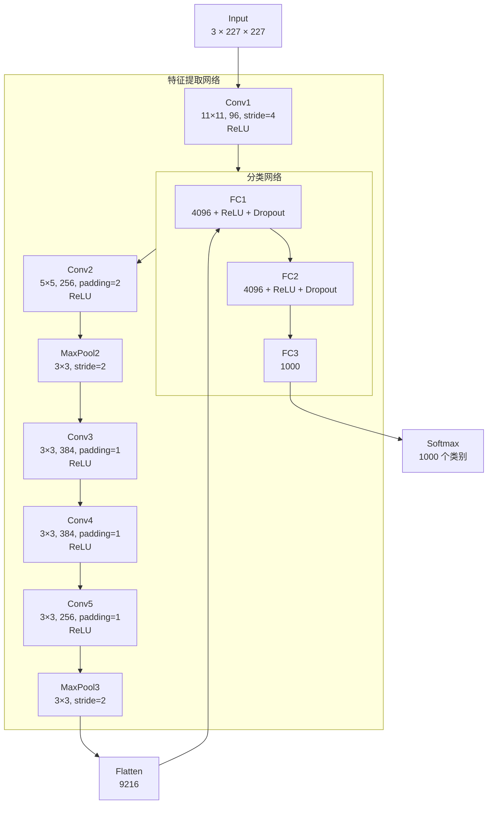
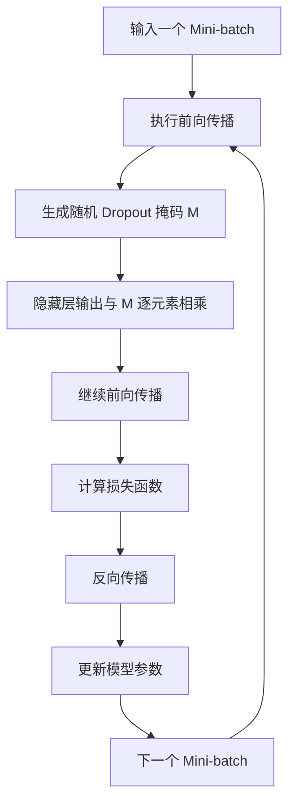

# AlexNet


## 诞生背景

2012 年，Alex Krizhevsky、Ilya Sutskever 和 Geoffrey Hinton 提出的 AlexNet 在 ImageNet 大规模视觉识别挑战赛（ILSVRC）中取得了突破性成绩。

在此之前，LeNet-5 已经证明了 CNN 在手写数字识别上的有效性，但在更大规模、更复杂的真实图像数据集上，CNN 尚未占据主导地位。

AlexNet 的重要突破在于：它证明了深层卷积神经网络可以在大规模自然图像分类任务上取得非常优秀的性能

AlexNet（2012）
- 5 个卷积层
- 3 个全连接层
- 约 6000 万个参数
- ImageNet 1000 类分类任务
- 使用 ReLU、Dropout、LRN 和数据增强等技术


## 整体网络结构

AlexNet 共有 8 个带可训练权重的层，5个卷积层 + 3个全连接层




相较于 LeNet-5，AlexNet 
* 网络更深，特征提取能力更强
* 使用 ReLU 替代 Sigmoid
* 从平均池化转向最大池化

更值得注意的是，AlexNet 在 Conv3, Conv4, Conv5 之间没有插入池化层，而是连续堆叠三个卷积层

>为什么这样设计

考虑三个连续的 $3 \times 3$ 卷积层，假设步幅为1
理论感受野变化为 3->5->7

连续堆叠卷积层还有两个重要优势
* 增加非线性表达能力
* 在通道数相同的情况下，连续小卷积核可以减少参数量


>第二个点，ReLU 比起 Sigmoid 有什么优势？

由图像我们可以发现，当输入进入饱和区间时候，Sigmoid 的梯度会非常小，而 ReLU 一直是 1
因此，在较深的网络中，ReLU 通常更有利于梯度传播，而且计算成本较低

当然，需要注意的是，ReLU 也存在负半轴梯度为 0 的情况，并不是所有情况下都更优


## Dropout

全连接层参数很多，几千万个，如此庞大的参数量带来了很强的拟合能力，但也增加了过拟合的风险

AlexNet 为此引入了一种重要的正则化技术：Dropout(随机失活)


### Dropout 的基本工作流程

1.在训练过程中，临时屏蔽一部分隐藏神经元
2.利用剩余神经元完成前向传播和反向传播
3.更新参与计算的网络参数
4.下一批训练数据重新选择需要屏蔽的神经元

所谓屏蔽就是临时将部分神经元的输出设置成 0 




假如，一个隐藏层输出：
$$
A=\begin{bmatrix}2.0&1.5&3.0&0.8\end{bmatrix}
$$
加入随机屏蔽第2，4个神经元，则
$$
M=\begin{bmatrix}1&0&1&0\end{bmatrix}
$$
得到
$$
A'=A\odot M=\begin{bmatrix}2.0&0&3.0&0\end{bmatrix}
$$
$M$ 就是掩码，针对一个隐藏层生成


### Dropout 的数学表达式

假设某个隐藏层的激活输出为
$$
A^{[l]}=g(Z^{[l]})
$$
定义 Dropout 掩码
$$
M^{[l]}_i\sim\operatorname{Bernoulli}(q)
$$
这里：
- $q$：神经元的保留概率（keep probability）。
- $p=1-q$：神经元的丢弃概率（dropout probability）。
- $M_i=1$：保留该神经元。
- $M_i=0$：屏蔽该神经元


加入 Dropout 后，隐藏层的输出就变成
$$
\widetilde A^{[l]}
=\frac{M^{[l]}\odot A^{[l]}}{1-p}
$$
即保留的神经元输出需要除以保留概率 $1-p$

进行缩放，可以使 Dropout 后的激活值期望与原始激活值相同


### Dropout 原理

>为什么它能缓解过拟合？

* 减少神经元之间的过度依赖

模型不能始终依赖某个固定的神经元组合，它需要学习在不同子网络下都比较有效的特征表示

* 模型集成

理论上，每个神经元都有保留和屏蔽两个状态，可以形成 $2^n$ 种掩码组合，通过随机采样掩码，让同一组参数可以在不同的子网络结构下得到训练，近似模型集成

* 向隐藏层注入乘性随机噪声

模型需要在随机扰动下仍然完成预测，有助于提高对隐藏表示变化的鲁棒性

>鲁棒性：一个系统、模型或过程在面对各种干扰、异常或变化时，仍能保持稳定、可靠运行的能力


### Pytorch 中实现 Dropout

```python
import torch
import torch.nn as nn

class Classifier(nn.Module):
    def __init__(self):
        super().__init__()

        self.classifier = nn.Sequential(
            nn.Linear(9216, 4096),
            nn.ReLU(),
            nn.Dropout(p=0.5),

            nn.Linear(4096, 4096),
            nn.ReLU(),
            nn.Dropout(p=0.5),

            nn.Linear(4096, 1000)
        )

    def forward(self, x):
        return self.classifier(x)
```


L2 正则化惩罚较大的权重，从而约束参数规模，Dropout 随机屏蔽神经元输出，引入随机性，从而降低对特定神经元组合的依赖，它们作用于不同的维度


## 数据增强 Data Augmentation

这也是一种缓解过拟合的方法

两者的区别在于：
- Dropout：在模型内部引入随机扰动。
- 数据增强：对输入样本进行合理变换，让模型学习对这些变换保持稳定的预测


### 水平翻转

水平翻转就是沿图像的垂直中轴线，将左右两侧交换

考虑一个 CNN 在训练集中只见过朝左的汽车。
如果没有数据增强，模型可能在一定程度上依赖汽车的朝向特征。
水平翻转可以让模型同时看到朝左和朝右的汽车，从而减少对特定方向的依赖

pytorch 实现

```python
from torchvision import transforms

train_transform = transforms.Compose([
    transforms.RandomHorizontalFlip(p=0.5),
    transforms.ToTensor()
])
```

在数据加载过程中动态随机生成增强样本


### 随机裁剪

原始 AlexNet 的经典训练流程会先将图像处理到约 $256\times256$，再从中随机提取 $227\times227$ 的图像区域，也就是说，同一张图片可以产生多个不同的裁剪结果

pytorch 实现

```python
from torchvision import transforms

train_transform = transforms.Compose([
    transforms.Resize((256, 256)),
    transforms.RandomCrop(227),
    transforms.RandomHorizontalFlip(p=0.5),
    transforms.ToTensor()
])
```


需要区分训练和验证阶段：
- 训练阶段：随机裁剪。
- 验证或测试阶段：通常采用确定性的裁剪或其他固定预处理


### PCA 颜色扰动

PCA 的思路是：先分析 RGB 通道之间的相关关系，再沿着颜色数据的主要变化方向添加随机扰动

PCA 就是 主成分分析


第一步，构建颜色数据矩阵，先对 RGB 通道进行归一化，然后将图像展开成二维矩阵
$$
X_{\text{flat}}=
\begin{bmatrix}
R_1&G_1&B_1\\
R_2&G_2&B_2\\
\vdots&\vdots&\vdots\\
R_N&G_N&B_N
\end{bmatrix}
$$
每一行对应一个像素

第二步，计算协方差矩阵，具体数学原理我不清楚，反正最后这个协方差矩阵描述了 RGB 颜色变化的统计结构

第三步，对协方差矩阵进行特征值分解，主要看颜色数据沿着哪一个主成分方向变化

第四步，生成随机颜色扰动


## LRN 局部响应归一化

全称，Local Response Normalization

核心思想，对局部的值进行归一化，使较大的响应相对更加突出，增强局部对比度


LRN 是 AlexNet 时代的一项重要设计，但它并没有成为后续 CNN 的标准组件，不太好用吧，不了解了


## 实验：数据增强是否改善服饰识别？

用 AlexNet 在 Fashion-MNIST 上训练两组。两组使用相同的初始权重、训练顺序和数据划分（48,000 张训练、12,000 张验证），批大小均为 256，各训练 20 轮，按验证准确率选取权重。

| 组别 | 训练预处理 | 权重 |
|---|---|---|
| 无增强 `baseline` | 缩放到 `227×227`，转为张量 | `baseline.pth` |
| 有增强 `augmented` | 原图以 50% 概率水平翻转，补 2 像素后随机裁回 `28×28`，再做相同缩放 | `augmented.pth` |

验证和测试不做随机增强。两组在同一份 10,000 张官方测试图上比较总体和各类准确率；`Delta (pp)` 是增强组减无增强组，单位为百分点。

在仓库根目录运行：

```bash
uv run python AlexNet/clothrecognition/model_train.py
uv run python AlexNet/clothrecognition/model_test.py
```

两份权重都保存在 `AlexNet/clothrecognition/`。

### 实测结果

在 RTX 4050 上训练并评估，差值为有增强组减无增强组。

| 指标 | 无增强 | 有增强 | 差值 |
|---|---:|---:|---:|
| 最佳验证准确率 | 92.57% | 91.79% | −0.78 个百分点 |
| **测试准确率** | **91.76%** | **90.91%** | **−0.85 个百分点** |
| 训练耗时（含验证和权重保存） | 1,404.2 秒 | 1,438.6 秒 | +34.4 秒 |

| 测试类别 | 无增强 | 有增强 | 差值（百分点） |
|---|---:|---:|---:|
| T 恤／上衣 | 89.90% | 87.70% | −2.20 |
| 裤子 | 98.40% | 98.90% | +0.50 |
| 套头衫 | 90.30% | 89.30% | −1.00 |
| 连衣裙 | 94.00% | 91.10% | −2.90 |
| 外套 | 83.50% | 86.30% | +2.80 |
| 凉鞋 | 98.70% | 98.10% | −0.60 |
| 衬衫 | 69.90% | 65.90% | −4.00 |
| 运动鞋 | 97.80% | 98.20% | +0.40 |
| 包 | 98.90% | 97.70% | −1.20 |
| 短靴 | 96.20% | 95.90% | −0.30 |

**本次增强没有改善总体表现。** 有增强组在测试集上净少判对 85 张，验证集结果也更低。外套净多判对 28 张，但衬衫、连衣裙、T 恤／上衣合计净少判对 91 张，抵消了外套等类别的收益。

当前实验组还是有点少，可以多加几组


