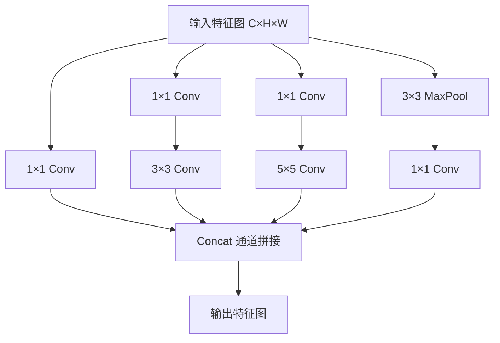
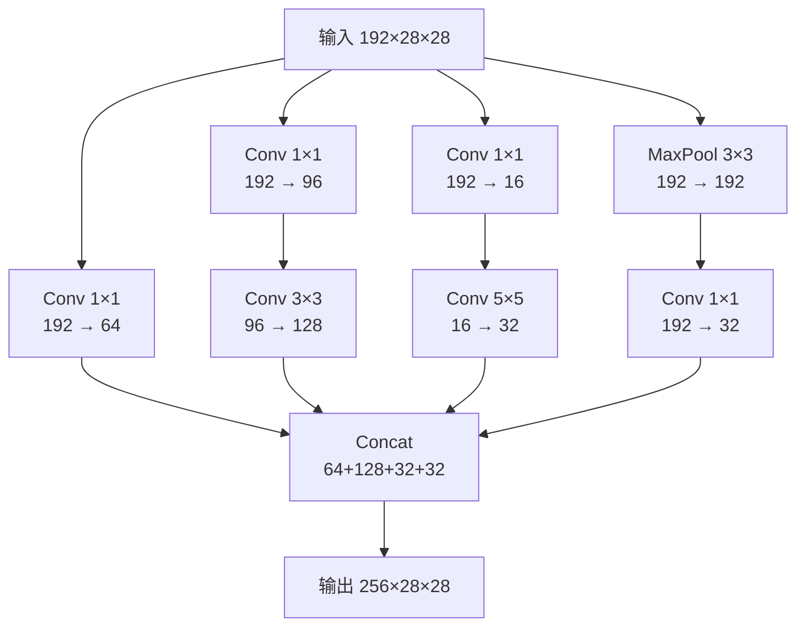
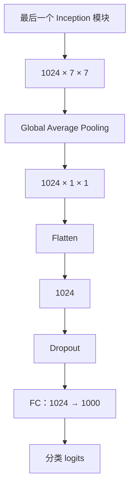
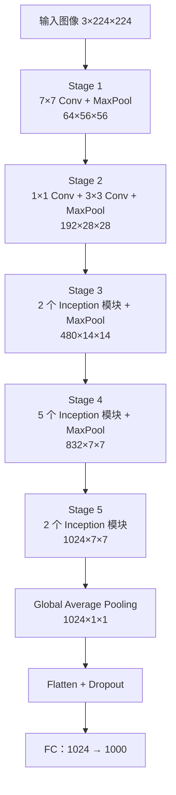
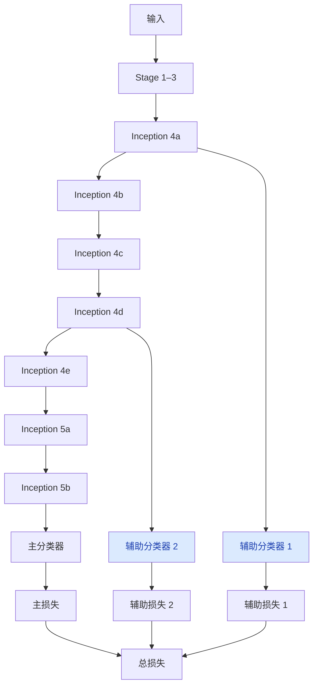
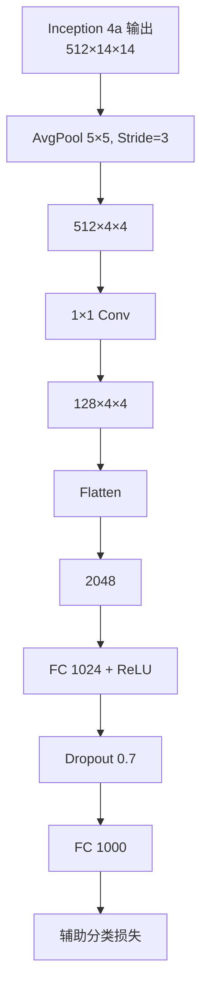
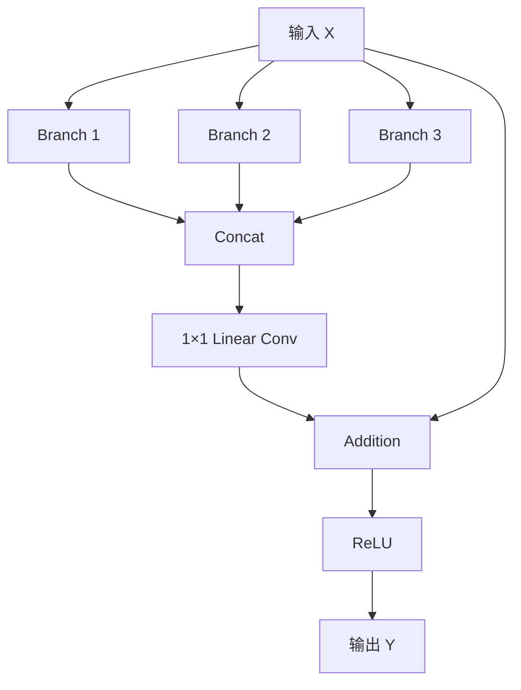

# GoogleNet 原理与实战 


## 诞生背景

GoogLeNet 是 Google 团队提出的卷积神经网络，在 2014 年 ImageNet 图像分类挑战赛中获得冠军，与上一章学习的 VGG 属于同一时期的经典网络

两者采用了不同的网络设计思路

VGG的核心思想：统一使用小卷积核，通过串行堆叠增加网络深度

而 GoogleNet 提出了另一个问题：能否在同一个模块中，同时使用不同尺寸的卷积核，从不同空间尺寸提取特征？

>使用不同尺寸的卷积核有什么用？

假设我们正在进行一项汽车图像识别任务，图像中存在不同尺度的视觉信息，例如车灯的边缘，车轮的局部形状，车身的整体轮廓

不同大小的卷积核可以从不同范围的局部区域提取信息

GoogleNet 尝试同时使用它们，然后将提取的特征合并起来


## Inception 模块

Inception Block 是 GoogleNet 的基本组成模块



四条路径接收同一个输入特征图，然后执行不同的特征变换


### 路径一：$1 \times 1$ 卷积

$$
Y_1=\operatorname{ReLU}(W_1*X+b_1)
$$
这里使用 $1 \times 1$ 卷积，可以用于调整输出通道数

>$1 \times 1$ 卷积对同一个空间位置的所有通道进行加权求和，不会改变空间尺寸，而卷积核的数量决定了通道数，可以调整输出通道数
加上一个激活函数，还能增强非线性表达能力


### 路径二： $1 \times 1$ 卷积 + $3 \times 3$ 卷积

首先使用 $1 \times 1$ 卷积调整通道数，然后使用 $3 \times 3$ 卷积提取空间特征


为什么这样？因为如果输入通道数很大，直接进行卷积的成本就会很高，可以先降维
这种结构也称为 Bootleneck 瓶颈结构
这样，参数量和计算量都会跟着减少，算一下就知道了


### 路径三： $1 \times 1$ 卷积 + $5 \times 5$ 卷积

和路径二的设计思想类似


### 路径四：$3 \times 3$ 最大池化 + $1 \times 1$ 卷积

首先进行最大池化，但这里的最大池化不是为了下采样，主要是保留局部区域中较强的特征响应，空间尺寸不变，然后通过 $1 \times 1$ 卷积进行通道调整


一个具体的 Inspection 模块




#### 通道拼接

这里是拼接不是相加，四条路径的特征图全部保留

```python
y = torch.cat([y1, y2, y3, y4], dim=1)
```


>Inception 模块为什么有效？

* 多尺度特征提取
不同大小的卷积核能同时从不同范围的空间区域提取信息，而不需要人为选择唯一的卷积核尺寸
* 增加网络宽度
VGG 主要通过串行叠加卷积层增加网络深度，而 Inception 在增加深度的同时，通过并行分支增加了网络宽度
* 合理分配计算资源
Inception 并没有为所有卷积核分配相同的通道数，而是通过调整各分支的输出通道数和中间通道数，在特征提取能力与计算成本之间取得平衡


## GAP 全局平均池化

全称，Gloabal Average Pooling，对每个通道的整个空间区域求平均值

$1 \times 1$ 卷积可以用于减少卷积部分的参数量，GAP 就是 GoogleNet 用于减少分类器部分参数量的工具

GoogleNet 不再直接将整张特征图展开后送入庞大的全连接层，而是先使用全局平均池化压缩空间维度


假设输入特征图为

$$
X\in\mathbb R^{B\times C\times H\times W}
$$
GAP 对每个通道独立进行平均池化
$$
y_{b,c}=\frac{1}{HW}\sum_{h=1}^{H}\sum_{w=1}^{W}X_{b,c,h,w}
$$
输出形状为
$$
Y\in\mathbb R^{B\times C\times1\times1}
$$
经过 Flatten 后：
$$
Y_{\text{flat}}\in\mathbb R^{B\times C}
$$
也就是说，无论每张特征图的空间尺寸有多大，GAP 都会将其压缩成一个数值





### 优点

>GAP有效在哪里

* 减少参数，限制分类器的复杂度，很直接的一点
* 缓解过拟合，直接 Flatten 会保留大量空间信息，而 GAP 会使用均值代替这些空间信息


正常直接 Flatten + FC
$$
z_k=\sum_{c=1}^{C}\sum_{h=1}^{H}
\sum_{w=1}^{W}W_{k,c,h,w}X_{c,h,w}+b_k
$$
同一个通道在不同空间位置拥有不同的权重，也就是分类器不仅可以学习某种特征是否存在，还可以学习该特征出现的位置

例如，训练集中猫总是出现在图像左上角，那么全连接分类器就可能过度依赖猫出现的位置，而不是真正学习猫的视觉特征


而 GAP + FC，相当于对分类器施加了一种结构约束：同一个通道在不同空间位置上共享分类权重，从而分类器更加关注某种特征在整张特征图上的总体响应，而不是它出现的具体位置


### 缺点

空间信息丢失，本质上 GAP 是一种多对一映射，并且不可逆，不适合直接用于需要空间定位的任务，比如目标检测之类的

并且
* GAP 会均匀分配空间维度上的梯度。
* GAP 无法直接为同一通道的不同空间位置提供不同的上游梯度。


### Pytorch 实现

直接使用`mean`

```python
import torch
x = torch.randn(8, 1024, 7, 7)
y = x.mean(dim=(2, 3))
print(y.shape)
```

```text
torch.Size([8, 1024])
```


更常见的网络定义方式，使用`AdaptiveAvgPool2d`

```python
import torch
import torch.nn as nn

gap = nn.AdaptiveAvgPool2d((1, 1))

x = torch.randn(8, 1024, 7, 7)
y = gap(x)

print(y.shape)
```

```text
torch.Size([8, 1024, 1, 1])
```


使用 GoogleNet 分类器

```python
classifier = nn.Sequential(
    nn.AdaptiveAvgPool2d((1, 1)),
    nn.Flatten(start_dim=1),
    nn.Dropout(p=0.4),
    nn.Linear(1024, 1000)
)

x = torch.randn(8, 1024, 7, 7)

y = classifier(x)

print(y.shape)
```

```text
torch.Size([8, 1000])
```


## Google 的完整网络结构



| 阶段 | 主要结构 | 输出尺寸 |
|---|---|---|
| Input | RGB 图像 | 3×224×224 |
| Stage 1 | Conv + MaxPool | 64×56×56 |
| Stage 2 | Conv + Conv + MaxPool | 192×28×28 |
| Stage 3 | 2 个 Inception + MaxPool | 480×14×14 |
| Stage 4 | 5 个 Inception + MaxPool | 832×7×7 |
| Stage 5 | 2 个 Inception | 1024×7×7 |
| GAP | 全局平均池化 | 1024×1×1 |
| Flatten | 展平 | 1024 |
| FC | 线性分类层 | 1000 |


### 辅助分类器

原始 GoogleNet 的一个重要设计，GoogLeNet 在训练时，除了最后的主分类器之外，还引入了两个辅助分类器，分别连接在 Inception 4a 和 Inception 4d 后面




对于较深的神经网络，损失函数位于网络末端，在反向传播时，梯度需要经过很多层才能到达网络前面的部分

GoogleNet 的设计者希望通过辅助分类器，在网络中间直接引入额外的建库信号，从而
* 改善中间层的梯度传播
* 鼓励中间层学习具有分类判别能力的特征
* 起到一定的正则化之作用

这种思想也称为 Deep Supervison 深度监督


#### 辅助分类器的结构




#### 总损失函数

$$
\mathcal L_{\text{total}}=\mathcal L_{\text{main}}+0.3\mathcal L_{\text{aux1}}+0.3\mathcal L_{\text{aux2}}
$$
所有分类器使用相同的真实类别标签

对于第一个辅助分类器之前的共享网络参数 $\theta$，梯度为
$$
\frac{\partial\mathcal L_{\text{total}}}{\partial\theta}=\frac{\partial\mathcal L_{\text{main}}}{\partial\theta}+
0.3\frac{\partial\mathcal L_{\text{aux1}}}{\partial\theta}+0.3\frac{\partial\mathcal L_{\text{aux2}}}{\partial\theta}
$$


整个模型参数量少了很多

| 部分 | 参数量 | MACs |
|---|---:|---:|
| Stem | 124,416 | 477.68 M |
| 9 个 Inception 模块 | 5,849,136 | 1,103.97 M |
| 主分类器 | 1,025,000 | 1.024 M |
| **总计** | **6,998,552** | **1,582.67 M** |

与 VGG-16 对比

| 指标 | VGG-16 | GoogLeNet |
|---|---:|---:|
| 网络深度 | 16 | 22 |
| 总参数量 | 138.36 M | 7.00 M |
| 计算量 | 15.47 GMAC | 1.58 GMAC |
| 分类器参数量 | 123.64 M | 1.025 M |
| 分类器参数占比 | 89.36% | 14.65% |
| FP32 权重存储 | 527.79 MiB | 26.70 MiB |


## 总结


### 设计思想

* 并行卷积提取特征
* 通道维度上的特征拼接
* 利用 $1 \times 1$ 卷积避免参数爆炸


### 局限性

* 网络结构较为复杂
* $5 \times 5$ 卷积的计算成本仍然较高
* 深层网络的优化问题仍然存在


### Inception的改进：卷积分解

这是后续 Inception 系列中非常重要的技术


使用两个 $3 \times 3$ 卷积替代一个 $5 \times 5$ 卷积
两种结构的理论感受野相同，但是参数减少了


非对称卷积分解
Inception 系列进一步提出：
能否将一个 $n \times n$ 卷积分解成
$$
1\times n\text{ Conv}
\rightarrow n\times1\text{ Conv}
$$

Inception 系列还有很多发展


### Inception 与 ResNet 的结合




## 猫狗识别

默认读取 `data/cat-and-dog/`：`train/` 和 `test/` 下各有 `cat/`、`dog/` 两个类别目录。脚本用固定种子从 `train/` 的每个类别中划出约 20% 做验证，不需要另建 `val/`；`test/` 只用于最终评估。同一张图片不要放进两个目录。

在仓库根目录运行：

```bash
uv run --locked python GoogleNet/cat-and-dog/model_train.py --epochs 8 --batch-size 64
uv run --locked python GoogleNet/cat-and-dog/model_test.py
```

训练脚本按验证集准确率选择最佳权重，默认保存到脚本同目录的 `GoogleNet/cat-and-dog/best_googlenet.pth`。

测试脚本默认读取同一个文件；两个脚本都可用 `--checkpoint` 指定其他权重路径。

`runs/` 只存放生成的图片，训练曲线默认写到 `runs/training_curves.png`，可用 `--output-dir` 指定图片目录。

训练和验证期间会分别显示批次进度条，整轮结束后再打印损失和准确率。CUDA 上默认使用自动混合精度（AMP），CPU 上仍使用 FP32。显存紧张时，可以先用 `--batch-size 32`；

想快速试跑一轮，再加 `--epochs 1`。


>实际训练出现一个问题
模型目前出现了单类预测：几乎不区分猫和狗，准确率一直在50，连续好多轮都是

这个问题这么解决？

看起来像是初始化放大了特征，而原学习率又让参数更新过猛，导致训练不稳定
改了学习率解决了

>可以引入 早停机制，下次会自动停止，就不需要自己手动停了


跑完了，结果是这样的

**默认 test 全集：准确率 84.97%（848/998）。**

| 真实类别 \ 预测类别 | cat | dog | 召回率 |
|---|---:|---:|---:|
| cat | 397 | 102 | 79.56% |
| dog | 48 | 451 | 90.38% |

可以看到模型偏向于判断狗而不是猫，根据`training_curves.png`可以看到 Loss 和 val acc 都不是很稳定，可以尝试把轮次提到 50 轮看看，能不能收敛


