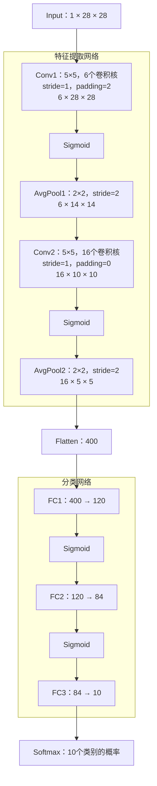

# LeNet-5


## 网络结构

LeNet-5 可以划分为两个部分
* 特征提取网络：两个卷积层和两个平均池化层
* 分类网络(Classifier)：三个全连接层





空间尺寸逐渐降低，通道数增加，使网络从像素级表示转向更抽象的特征表示


## 参数详解

| 网络层 | 输出形状 | 可训练参数量 |
|---|---|---:|
| Input | 1×28×28 | 0 |
| Conv1 | 6×28×28 | 156 |
| AvgPool1 | 6×14×14 | 0 |
| Conv2 | 16×10×10 | 2416 |
| AvgPool2 | 16×5×5 | 0 |
| Flatten | 400 | 0 |
| FC1 | 120 | 48120 |
| FC2 | 84 | 10164 |
| FC3 | 10 | 850 |
| **合计** | — | **61706** |


我们发现全连接层的参数还是远远大于卷积层的，这还是有了全局平均池化压缩空间维度的情况下


### 网络计算量 MACs

参数量和计算量是两个不同的概念
- Params：衡量模型需要存储多少可训练参数。
- MACs（Multiply-Accumulate Operations）：衡量模型前向传播需要执行多少乘加操作。
- FLOPs：衡量浮点运算次数，通常一次 MAC 近似对应两次 FLOPs


卷积层计算量，对于普通二维卷积
$$
\text{MACs}=H_{\text{out}}W_{\text{out}}
C_{\text{out}}C_{\text{in}}K_hK_w
$$
全连接层
$$
MACs = n_{in} \times n_{out}
$$

算一下我们会发现，计算量主要都在卷积层，为什么呢
卷积层采用了权重共享，同一个卷积核在特征图上不断滑动，每个权重都会被重复使用多个


## 总结

LeNet-5 确立了经典 CNN 的基本设计方式：逐渐降低空间分辨率，增加通道数，最后使用全连接层完成分类

从参数量和计算量的角度，我们还可以进一步理解：
- 卷积层通过权重共享减少参数量，但空间上的重复计算使其计算量较大。
- 池化层降低空间分辨率，可以减少后续网络的计算量。
- Flatten 后的特征维度直接影响第一个全连接层的参数量


## Fashion-MNIST 服饰识别

在 `LeNet/clothrecognition/` 目录运行训练脚本，结束后它会在当前目录保存验证准确率最高的 `model.pth`。测试命令：

```bash
uv run python model_test.py            # 只评估 LeNet
uv run python model_test.py --compare  # 与已训练的 ResNet-18 服饰识别模型对比
```

两种模型共用仓库根目录下的 Fashion-MNIST 官方测试集（10,000 张）。
脚本输出总体准确率、各类准确率和可训练参数量，并把 LeNet 混淆矩阵保存到 `LeNet/clothrecognition/runs/confusion_matrix.png`。
`--compare` 读取 `ResNet/Fashion-MNIST-clothsrecognition/model.pth`，不会重新训练。


### 实测：LeNet 对比 ResNet-18

两份已训练权重在 CUDA 上评估同一份官方测试集，每类 1,000 张。下表的类别准确率以该类的真实样本数为分母，差值为 ResNet-18 减 LeNet。

| 指标 | LeNet | ResNet-18 | 差值（百分点） |
|---|---:|---:|---:|
| **总体准确率** | **83.55%** | **91.02%** | **+7.47** |
| T 恤／上衣 | 84.10% | 84.40% | +0.30 |
| 裤子 | 95.40% | 98.40% | +3.00 |
| 套头衫 | 74.90% | 87.50% | +12.60 |
| 连衣裙 | 88.00% | 92.10% | +4.10 |
| 外套 | 69.80% | 83.40% | +13.60 |
| 凉鞋 | 96.30% | 96.90% | +0.60 |
| 衬衫 | 44.60% | 75.70% | +31.10 |
| 运动鞋 | 90.10% | 98.90% | +8.80 |
| 包 | 96.20% | 98.60% | +2.40 |
| 短靴 | 96.10% | 94.30% | −1.80 |

**差距主要集中在相近的上衣类别。** ResNet-18 总共净多判对 747 张，其中衬衫、外套、套头衫贡献了 573 张，约占 77%。从本地生成的 [LeNet 混淆矩阵](clothrecognition/runs/confusion_matrix.png) 看，真实的衬衫有 240 张被判成 T 恤／上衣，155 张被判成套头衫；外套被误判成套头衫有 139 张，反方向有 122 张。短靴是本次 LeNet 唯一领先的类别。

**取舍是准确率与参数量。** LeNet 有 61,706 个可训练参数，ResNet-18 有 11,178,378 个，后者约为前者的 181 倍。LeNet 适合作为轻量基线；如果更在意衬衫、外套等类别的识别效果，这次结果支持选 ResNet-18。


