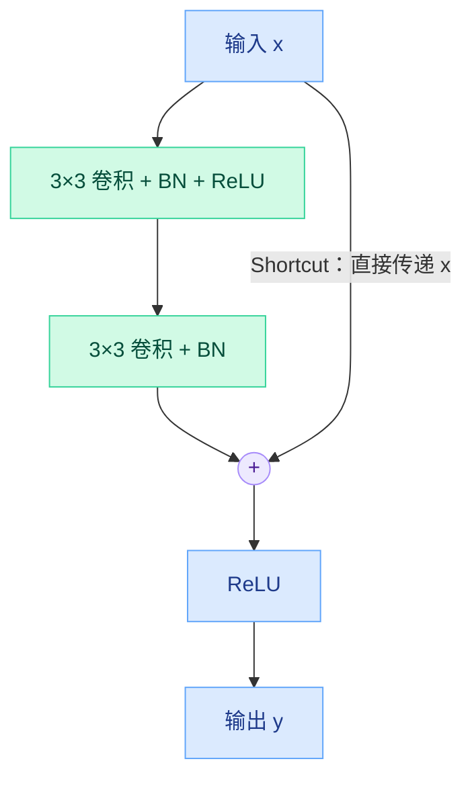
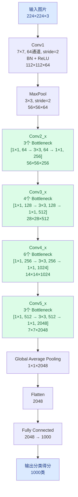
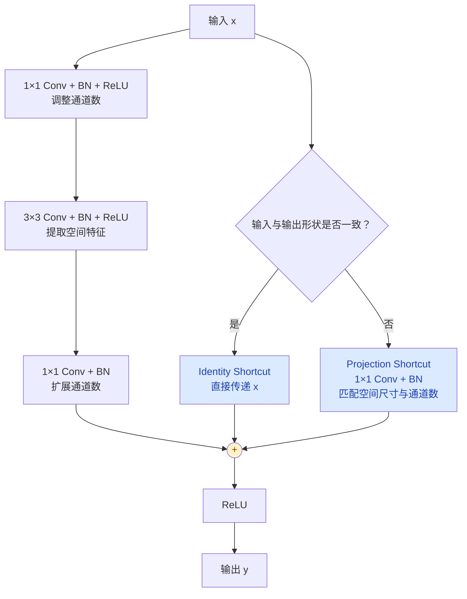

# ResNet 原理

我们以下面的逻辑展开
* ResNet 的诞生背景
* 残差学习的核心思想
* 残差块的结构
* Batch Normalizetion
* ResNet 的完整网络结构
* PyTorch 实现残差块


## 诞生背景

回顾 CNN 的一个重要特点，随着网络层数增加，神经网络可以逐渐组合出更复杂的特征

比如，在图像分类任务中
* 浅层卷积可能提取边缘，颜色和纹理
* 中间层可能组合出局部形状
* 深层可能提取出更复杂的物体结构

因此，一个很自然的想法是，如果 20 层神经网络表现不错，那么将它加深到 50 层，100 层，是不是就能获得更好的效果？

从模型的表达能力来看，增加网络深度通常能够提供更大的函数表示空间，但是

模型能够表示为某个函数，不代表训练算法一定能够找到这个函数


>网络加深会遇到什么问题

* 梯度消失

我们都知道，神经网络通过反向传播计算梯度
$$
\frac{\partial J}{\partial a^{(1)}}=
\frac{\partial J}{\partial a^{(L)}}
\frac{\partial a^{(L)}}{\partial a^{(L-1)}}
\cdots
\frac{\partial a^{(2)}}{\partial a^{(1)}}
$$
为了说明问题，我们考虑一个简化，假设每经过一层，反向传播的梯度都乘以 0.5
当层数达到 20 层，梯度已经很小很小
这可能导致较浅层的参数更新缓慢，使网络难以训练

* 梯度爆炸

反过来，假设每经过一层，梯度乘以 1.5，20层后，这个数很大，梯度迅速增大，导致参数更新不稳定，甚至出现数值溢出

深层网络训练需要考虑梯度的数值稳定性

不过，梯度消失和梯度爆炸不是 ResNet 关注的问题

* 网络退化

有研究人员比较了两个普通的深层神经网络
* 20 层网络
* 56 层网络

直觉上，56 层网络更深，应该有更强的表达能力，但实际上，56 层不仅测试误差更高，训练误差也更高      

这就是网络退化

这不是过拟合，如果是过拟合的话，训练误差应该更低


我们来做一个思想实验，假设现在有一个训练好的 20 层神经网络
$$
H(x)=f_{20}\circ f_{19}\circ\cdots\circ f_1(x)
$$
想要把它扩展层 23 层，只需要在原来的网络中额外插入 3 个恒等映射层
$$
I(x) = x
$$
那么
$$
H_{new}(x) = H(x)
$$
也就是说，如果新增的层能够实现恒等映射，那么更深的网络至少可以保留原来网络的表现
如果新增的层能够学习到由于的特征，模型甚至可能进一步改善

但问题是，实际训练中，普通深层网络很难自动学出这些恒等映射，普通神经网络有一个非线性的激活函数

比如
$$
H(x)=W_2\operatorname{ReLU}(W_1x+b_1)+b_2
$$
想要 $H(x) = x$，参数之间要配合一下


基于这个问题，ResNet 的核心思路由此产生

既然希望新增的网络层在没有学到有用信息时能够保持恒等映射，那么为什么不直接网络提供一条恒等传递路径？

普通网络需要学习 $H(x)$，ResNet 则让一部分网络学习 $F(x) = H(x) - x$，最后输出 $H(x) = F(x) + x$

$F(x)$ 就是残差映射

如果新增的网络层暂时不需要改变输入，只要 $F(x) = 0$，就可以得到 $H(x) = x$

这通常比一串普通非线性层直接学习完整的恒等映射更容易优化


## 残差块的基本结构

前面提及 ResNet 的核心思想就是：让网络学习残差 $F(x)$，而不是直接学习完整的映射 $H(x)
$$
H(x) = F(x) + x
$$
但这个公式究竟如何变成一个真正的神经网络？

这一节我们通过讲解 ResNet 的基础架构 -- 残差块，来回答这个问题


### 普通网络与残差网络的区别

先看普通的两层神经网络
$$
H(x)=W_2\sigma(W_1x+b_1)+b_2
$$
普通网络直接使用这个结果作为输出

而残差网络增加了一条路径，将原始输入 $x$ 直接传递到后面，与两层的输出相加




我们可以看到，输入 $x$ 被分成两条路径
* 残差分支，经过卷积，BN，ReLU 等操作，得到 $F(x)$
* 捷径分支 Shortcut Path，直接传递输入

最终两条路径相加

如果某些额外的网络层暂时没有学到有用的变换，它们可以让残差分支输出接近 0，从而保留原有信息，相比之下，普通网络需要依靠多个权重矩阵和非线性激活函数的配合，才能实现相同的映射


>Shortcut 还对反向传播有帮助，为什么？

$$
H(x) = F(x) + x
$$
求导
$$
\frac{dH}{dx}=\frac{dF}{dx}+1
$$

梯度
$$
\frac{dJ}{dx}
=
\frac{dJ}{dH}
\left(
\frac{dF}{dx}+1
\right)
$$
打开
$$
\frac{dJ}{dx}
=
\frac{dJ}{dH}
\frac{dF}{dx} + \frac{dJ}{dH}
$$
这说明，梯度可以通过两条路径传递
* 一条经过残差分支
* 一条经过恒等 Shortcut 分支

即使残差分支中的某些梯度较小，shortcut 仍然提供了一条直接的梯度传播路径


不过还有一个问题，残差分支可能会改变张量的形状，这时候 shortcut 分支需要调整以适配残差分支的空间尺寸变化
所有最终是这样的
$$
H(x) = F(x) + W_s(x)
$$
其中 $W_s$ 表示 shortcut 分支中的投影变换


## Batch Normalization 批量归一化

前面我们学习的残差块的结构
$$
y = ReLU(F(x) + x)
$$
其中残差分支通常由下面的结构组成

```text
Conv → BN → ReLU → Conv → BN
```

比起之前多了一个 BN，那么它是什么呢？


我们回忆一下训练一个模型的一个常见操作：对输入特征进行标准化，对特征进行缩放

但神经网络存在一个新问题，我们不仅需要考虑输入数据，还需要考虑后续隐藏层的输入

在训练过程中，卷积层1的参数 $W_1$ 会不断更新，即使输入 $X$ 不变，卷积层1的输出也会发生变化，也就是卷积层2接收到的特征分布可能在训练过程中不断变化

所以就有了 BN，在神经网络内部，对中间特征进行归一化，使训练过程更加稳定


>BN 究竟对什么进行归一化

BN 全称，Batch Normalization，批量归一化

假设每次送入网络 64 张图片，假设某一层有一个特征，在当前 Batch 中得到4个数值
$$
B = {2, 4, 6, 8}
$$
第一步计算均值
$$
\mu_B=\frac{1}{m}\sum_{i=1}^{m}x_i
$$
第二步计算方差
$$
\sigma_B^2=\frac{1}{m}\sum_{i=1}^{m}(x_i-\mu_B)^2
$$
第三步标准化
$$
\hat{x}_i=\frac{x_i-\mu_B}{\sqrt{\sigma_B^2+\epsilon}}
$$
到这里就只是普通的标准化操作

其实我们强制每一层的输出都保持均值为0，方差为1，可能限制神经网络对特征分布的调整能力，有些特征可能具有较大的数值范围，有些特征可能需要整体向正方向偏移

因此，BN 引入两个可学习参数
 * $\gamma$ 缩放参数 Scale
 * $\beta$ 平移参数 Shift

BN 最终输出为 
$$
y_i  = \gamma x_i + \beta
$$ 

每个通道都有一组参数


>为什么对隐藏层的输出进行归一化，就有可能让神经网络训练得更快，更稳定？

* 归一化使隐藏层的输出更加稳定，更平缓，从而可以允许使用更大的学习率
* 而且，它可以缓解梯度消失和梯度爆炸问题


## ResNet-50 的完整网络结构

我们以 ResNet -50 为例子，它是一种深度卷积神经网络，通过残差连接改善深层网络的训练过程




* 特征图的空间尺寸逐渐减小 224->112->56->28->14->7
* 特征图的通道数逐渐增加 3->64->256->512->1024->2048

空间尺寸减少可以降低后续卷积的计算开销，而通道数增加使网络能够表示更多不同的特征

> 为什么叫做 ResNet-50？

四个残差阶段分别包含 3，4，6，3 个 Bottleneck，因此，总数量为 16
每个 Bottleneck 的主分支包含三层卷积
因此，残差阶段一共有 48 层卷积
再加上最开始的卷积层和最后的全连接层 一共 50 层卷积


### 
### Bottleneck

Bottleneck 翻译为瓶颈结构，它由三层卷积构成




* 第一层 $1 \times 1$ 卷积，不改变空间尺寸，可以调整通道维度数，减少后续计算量
* 第二层 $3 \times 3$ 卷积，这一层负责提取空间特征
* 第三层 $1 \times 1$ 卷积，扩展通道维数


