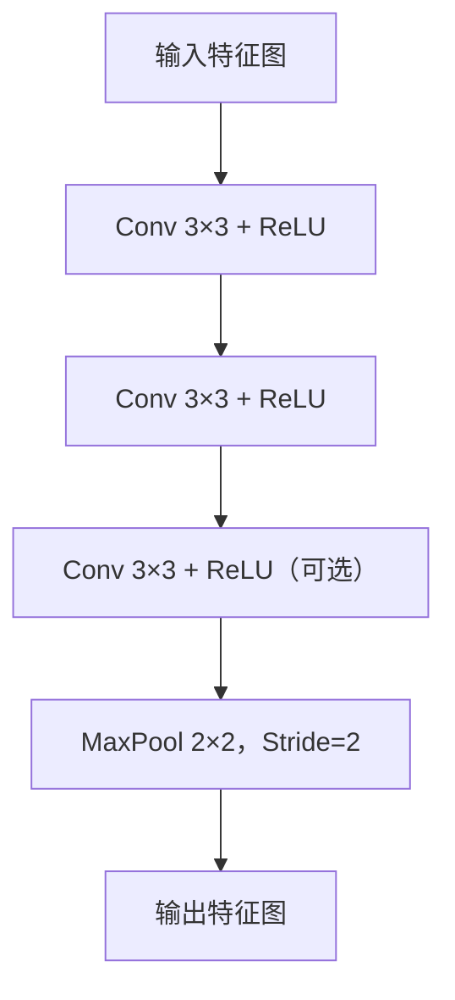
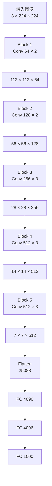

# VGG 原理与实战


## 诞生背景与核心设计思想

前面 AlexNet 在 2012 年取得了重要突破，证明了深度卷积神经网络在大规模图像分类任务中的潜力，它的主要结构是 5 个卷积层 + 3 个全连接层

但是，AlexNet 的网络设计并不十分规整，它使用了不同尺寸的卷积核
* conv1 $11 \times 11$
* conv2 $5 \times 5$
* conv3  $3 \times 3$
* conv4  $3 \times 3$
*  conv5  $3 \times 3$

那么，一个自然的问题就出现了

>如果我们不再使用复杂的大卷积核，而是统一使用小卷积核，不断增加网络深度，能否取得更好的效果

这就是 VGG 研究的核心问题


VGG 最有代表性的版本是 VGG-16：13个卷积层 + 3个全连接层


### 核心设计


#### 统一使用 $3 \times 3$ 卷积核

VGG 将卷积核统一为 
$$
 K = 3, S = 1, P = 1
$$

这样，特征图空间尺寸可以保持不变，并且随着卷积核增加，感受野不断扩大


#### VGG Block

将多个卷积核组织成一个 Block，在 Block 末尾使用最大池化进行下采样
其中卷积核负责保持空间尺寸进行多次特征提取，然后通过池化降低空间分辨率

一个典型的 VGG Block 可以表示为




VGG-16 的前两个 Block 各包含两个卷积层，后三个 Block 各包含三个卷积层

池化层负责将特征图的高度和宽度减半
$$
224\rightarrow112\rightarrow56\rightarrow28\rightarrow14\rightarrow7
$$
这种设计带来了两个好处
首先，卷积层负责提取特征，池化层负责降低空间分辨率，分工非常清晰
其次，整个网络可以通过重复堆叠 Block 来构建，结构更加规整，也更容易实现和扩展


## VGG-16 整体网络结构

下图是原版 VGG-16 在 ImageNet 上使用的结构，输入为 RGB 图像。服饰识别实验改用单通道输入。




VGG-16 可以分成两个部分
* 特征提取部分：5个 VGG Block，共13个卷积层
* 分类部分：三个全连接层，最终输出 1000 个类别的预测结果

需要注意的是：每个 Block 的输出尺寸都是经过最大池化之后的尺寸

* Block1，提取初级视觉特征
* Block2，提取更复杂的局部特征
* Block3，它包含三个卷积层，前面都是两个，进一步加深网络，网络通过更深的非线性变换，能够组合前面提取的边缘，纹理和形状特征，形成更复杂的局部表示
* Block4，到这个阶段，特征图的空间分辨率明显降低，通道数增加到了 512
* Block5，最后的卷积特征提取
* 最后三个全连接层
  * FC1：4096 个神经元，使用 ReLU 和 Dropout。
  * FC2：4096 个神经元，使用 ReLU 和 Dropout。
  * FC3：1000 个神经元，对应 ImageNet 的 1000 个类别


经过参数量分析与计算量分析
大约有 1.38 亿个参数，其中约 90% 来自全连接层
但是计算量大部分来自卷积层


| 模块 | MACs |
|---|---:|
| Block 1 | 1.94 G |
| Block 2 | 2.77 G |
| Block 3 | 4.62 G |
| Block 4 | 4.62 G |
| Block 5 | 1.39 G |
| 三个 FC 层合计 | 0.124 G |
| **总计** | **约 15.47 G** |

这里的 G 表示十亿次 MACs，统计的是一次前向传播中的主要乘加操作，不包含池化、激活等其他运算


## 总结

* 连续的 $3 \times 3$ 卷积核 + 激活函数可以以相对经济的参数量构建更复杂的特征变换
* 使用 Block 可以使网络定义非常简洁，有助于设计复杂网络


## 实战：服饰识别

本实验将 Fashion-MNIST 的 `28 × 28` 灰度图缩放到 `64 × 64`。训练、验证和测试都输入 `[1, 64, 64]` 的单通道张量。五次池化后得到 `512 × 2 × 2` 的特征图，展平后由分类头输出 10 类分数。

>因为 $224 \times 224$ 太慢了

在 `VGG/clothrecognition` 目录运行：

```powershell
uv run --locked model_train.py
uv run --locked model_test.py
```

训练脚本将官方训练集固定划分为 48,000 张训练图和 12,000 张验证图，默认训练 20 轮，训练和验证的批次大小均为 512。CUDA 上使用 FP16 自动混合精度和梯度缩放，CPU 上保持 FP32。每轮显示批次进度和指标；验证准确率最高的一轮保存为同目录的 `model.pth`，训练曲线保存到 `runs/learning_curves.png`。

测试脚本加载 `model.pth`，在独立的 10,000 张官方测试图上输出总体和各类别准确率，并把混淆矩阵保存到 `runs/confusion_matrix.png`。

旧版 `224 × 224` 的权重与新版分类头不兼容，请重新训练生成 `model.pth` 后再测试。


### 测试结果

在 RTX 4050 Laptop GPU 上使用 CUDA 混合精度评估 `model.pth`。Fashion-MNIST 官方测试集共 10,000 张图像，每类 1,000 张；总体准确率为 **91.57%（9,157 / 10,000）**。

| 类别 | 正确数 | 准确率 |
|---|---:|---:|
| T 恤／上衣 | 846 | 84.60% |
| 裤子 | 983 | 98.30% |
| 套头衫 | 878 | 87.80% |
| 连衣裙 | 879 | 87.90% |
| 外套 | 909 | 90.90% |
| 凉鞋 | 972 | 97.20% |
| 衬衫 | 752 | 75.20% |
| 运动鞋 | 982 | 98.20% |
| 包 | 990 | 99.00% |
| 短靴 | 966 | 96.60% |

包的识别准确率最高，衬衫最低。最常见的误判是把 T 恤／上衣判为衬衫（108 张），其次是把衬衫判为 T 恤／上衣（87 张）和套头衫（71 张）。


