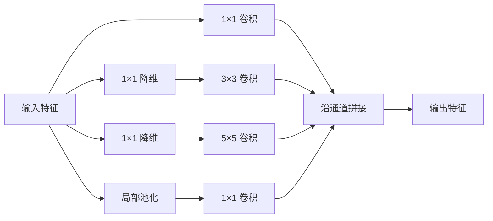
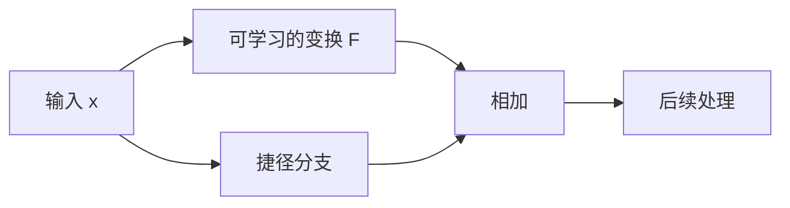

# 卷积神经网络：

卷积神经网络（Convolutional Neural Network，CNN）是一类特别适合处理图像等具有空间结构的数据的神经网络。

LeNet、AlexNet、VGG、GoogLeNet 和 ResNet 都属于 CNN。它们不是五种完全不同的学习算法，而是对“如何组织网络，让它更有效地提取图像特征”的不同回答。

## 一、为什么图像需要专门的网络结构

一张图像并不只是一串像素数值。像素之间的位置关系也携带信息：相邻像素可能共同组成一条边，一组边可能组成轮廓，不同轮廓又可能组成一个物体。

把图像展开为向量后交给全连接网络，仍然可以完成分类。但这种结构不会直接利用图像的空间规律：

- **局部关联**：判断一小块区域是否存在边缘，通常不需要同时查看整张图。
- **模式可复用**：同一种边缘或纹理，可能出现在图像的不同位置。
- **特征可组合**：简单的局部模式，可以逐层组合为更复杂的结构。

全连接网络可以从数据中学习这些规律，但需要为不同位置分别学习大量连接。CNN 则把局部连接和参数共享直接放进结构中，减少需要学习的参数，并让同一种模式能在不同位置被识别。

这是一种**归纳偏置**：模型预先采用了适合某类数据的结构假设。它不是直接告诉网络“猫长什么样”，而是告诉网络“可以在不同位置寻找相似的局部模式”。

## 二、卷积到底在做什么

### 1. 卷积核：在局部区域内计算一个响应

可以把卷积核理解为一小组可学习的权重。它覆盖图像的一个局部区域，对区域中的数值进行加权求和，再移动到下一个位置，重复同样的计算。

一个卷积核在不同位置使用**同一组权重**，这就是参数共享。

例如，一组权重可能对竖直明暗交界产生较强响应。让它遍历图像，就能得到“哪些位置更像竖直边缘”的信息。

不过，这只是帮助理解的例子。实际训练中，卷积核的权重由损失函数和反向传播学习得到，不需要人为指定每个核检测什么。

### 2. 特征图：记录某种模式在哪里出现

一个卷积核在各个位置产生的响应，组成一张**特征图**（feature map）。

它保留了空间排列，因此不仅表示“是否出现某种模式”，还保留“这种模式大致出现在哪里”。通常还会经过非线性激活，得到供下一层使用的特征。

一层可以学习多组卷积核，产生多张特征图，以描述不同的模式。把这些特征图叠在一起，就形成了多个特征通道。

需要区分两种“通道”：

- 输入图像的 RGB 通道，分别表示红、绿、蓝的像素分量。
- 隐藏层的特征通道，表示网络学习到的不同响应，不再必须对应某种颜色。

一个标准卷积层的输出通道通常会综合所有输入通道的信息，而不是简单地对每个颜色通道各做各的检测。

### 3. 局部连接：为什么能减少参数

全连接层中的一个神经元会连接上一层的所有输入；卷积层中的一个输出位置，只连接输入中的一个局部区域。

同时，同一个核在不同位置复用权重。因此，图像变大时，卷积运算的位置会增多，但在输入、输出通道数不变的情况下，卷积核本身的参数数量不会随图像面积一起增加。

**参数少不等于计算量一定小。** 对很大的特征图反复执行卷积，仍可能消耗大量计算和显存。

### 4. 步幅与填充

**步幅**（stride）表示卷积核每次移动多远。步幅越大，通常得到的特征图越小，计算量也会减少，但空间细节会损失得更多。

**填充**（padding）是在输入边缘补上一圈数值，常见的是补零。它可以控制输出大小，也让边缘位置有机会参与更多局部计算。

它们主要影响网络如何处理空间分辨率，不改变“局部计算、共享权重”的基本思想。

## 三、CNN 如何逐层理解图像

### 1. 从简单特征到复杂特征

浅层往往更容易学习局部的明暗变化、边缘和纹理；更深的层可以组合前面的特征，形成对轮廓、部件乃至类别相关结构的响应。

这里的“边缘—部件—物体”是概念化描述，不是固定规则。并不是每个通道都对应一个人能准确命名的特征，也不是网络一定会按人为理解的顺序识别物体。

CNN 的特点是：**特征提取本身也是学习过程的一部分**，而不是先由人设计完所有图像特征，再单独训练分类器。

### 2. 感受野：一个特征能看到多大的输入范围

**感受野**（receptive field）指某个特征位置能够受到原始输入中多大范围的影响。

单层小卷积只查看一小块区域；堆叠多层后，后面的特征会间接接收到更大范围的信息。因此，小卷积也可以通过逐层组合，描述较大尺度的结构。

感受野扩大，只说明信息可能来自更大的范围，不代表网络一定有效利用了范围内的所有信息。

### 3. 池化与下采样：保留信息，减少空间规模

**下采样**是降低特征图空间分辨率的操作。池化和带步幅的卷积都可以完成下采样，但它们不是同一种操作。

池化把一个局部区域汇总为一个数值：

- **最大池化**：保留区域内最大的响应，强调较强的特征。
- **平均池化**：保留区域内的平均响应，概括整体情况。

常规的最大池化、平均池化本身没有需要学习的权重。带步幅的卷积则在降低分辨率的同时进行可学习的特征变换。

减少分辨率有助于降低后续计算量，也会丢失精确位置信息。因此，图像分类可以较积极地压缩空间尺寸，而需要精确定位的任务往往还要保留或恢复空间细节。

### 4. 从特征到类别

分类网络最终需要把空间特征汇总为每个类别的分数。常见方式有：

- 展开特征后交给全连接层，学习不同位置、不同通道的组合。
- 使用全局平均池化，对每个通道的空间响应取平均，再进行分类。

前者能够保留更多与位置相关的组合，但直接连接较大的特征图时，参数数量可能很大。后者压缩得更强，常用于减少分类头参数，但也不再保留精确的空间排列。

卷积层、激活、池化、全连接层共同组成 CNN。**CNN 不是“所有层都是卷积层”。**

## 四、LeNet：理解 CNN 的基本范式

LeNet 是早期经典卷积神经网络，代表性应用是手写字符识别。

它展示了一种清楚、直接的思路：先通过卷积学习局部图像特征，逐步压缩空间信息，再根据提取出的特征完成分类。

对于手写数字，原始像素之间的微小差异并不是最终目标。更有用的信息可能是某处是否存在笔画、几段笔画如何组合、它们是否形成封闭轮廓。卷积与逐层组合，让网络有机会自动建立这样的表示。

LeNet 的结构相对简单，适合用来理解三个基本问题：

- 图像如何从像素变成特征。
- 特征如何经过多层组合变得更有判别力。
- 图像特征如何最终支持分类。

它的重要性在于建立了 CNN 的基本范式，不在于适合所有现代复杂视觉任务。面对高分辨率、多样化场景时，小型网络的表示能力往往不够。

## 五、AlexNet：让较深的 CNN 用于大规模图像识别

AlexNet 在 2012 年的 ImageNet 图像分类竞赛中取得了重要突破，推动了深度卷积网络在计算机视觉中的广泛应用。

与 LeNet 面对的相对简单图像相比，自然图像中的背景、光照、视角和物体外观更加多变。仅识别简单笔画是不够的，需要更丰富的特征表示。

AlexNet 的代表性特点，不只是增加网络规模，还包括把多种有助于训练的方法组合起来：

- **ReLU**：在正值区域不会像 Sigmoid 那样随着输入变大而逐渐饱和，有助于优化；但它并不保证消除所有梯度问题。
- **Dropout**：训练时随机屏蔽部分单元的输出，降低模型对某些固定特征组合的依赖，起到正则化作用。
- **数据增强**：通过裁剪、翻转等变换增加训练样本的变化，帮助模型学习对合理外观变化的适应能力。
- **GPU 训练**：让较大模型所需的计算更加可行。

这些方法并不全由 AlexNet 首创。它的重要贡献之一，是证明了较深的 CNN 配合足够的数据、计算资源与合适的训练方法，能在复杂图像识别中取得显著效果。

相应代价是：模型更大，训练和推理成本更高，也更需要防范过拟合。

## 六、VGG：用统一的小卷积构建深层网络

VGG 的特点是结构规整：反复使用较小的卷积核，把网络逐步加深。

### 为什么不直接使用一个很大的卷积核

一个较大的卷积核可以一次覆盖较大的区域，但也需要较多参数。多个小卷积层可以逐步扩大感受野，并在中间加入更多非线性变换。

例如，在步幅等条件合适时，两层连续的 3×3 卷积可以获得与一层 5×5 卷积相同大小的理论感受野；在通道宽度相同、忽略偏置的比较中，两层 3×3 卷积的参数更少。

但它们并不等价：两层之间加入激活后，表达的是更复杂的非线性变换，而不是简单地把一个大核拆开。

### 深度带来的能力与代价

更深的网络可以进行更多次特征组合，因此有机会学习更复杂的表示。VGG 说明了，即使基本模块很简单，合理地增加深度也可以形成强大的图像表示。

“结构简单”不代表“计算便宜”。经典 VGG 网络的计算与存储成本较高，大型全连接分类头也会占用很多参数。

VGG16 中的“16”按照通常的命名口径，指带权重的层数，而不是把激活、池化等所有操作都算进去。

## 七、GoogLeNet：在同一层中观察不同尺度

图像中的有效信息有不同尺度：一小块纹理可能有用，一个较大的轮廓也可能有用。如果每层只选择一种卷积尺度，就需要提前决定应该重点关注哪一种范围。

GoogLeNet 的核心是 **Inception 模块**：让同一份输入经过多个并行分支，各分支提取不同类型或不同尺度的信息，再把结果组合起来。

### 为什么需要多个分支

多分支让后续网络能够同时使用不同的描述，而不是强迫所有信息先通过同一种处理方式。

这里的“拼接”是保留各个分支产生的特征，将它们放到一起，并不是对各分支的结果求平均，也不是逐元素相加。

### 1×1 卷积为什么有用

1×1 卷积不扩大当前层所观察的空间邻域，但可以把同一位置的多个输入通道重新组合，产生新的通道。

当它减少通道数量时，后续较大卷积核就能在更窄的特征表示上运算，从而降低计算与参数成本。这常被称为通道降维或瓶颈设计；它不是把图像的高、宽缩小。

GoogLeNet 的代表性思想是：不只考虑“继续加深”，还考虑“同一阶段怎样并行提取更多样的特征，并控制成本”。

它的模块比 VGG 更复杂，但也说明了模型能力与参数规模并不是简单的一一对应关系。更复杂的连接方式，也不保证在所有硬件上都运行得更快。

## 八、ResNet：让网络学习对输入的修正

更深的网络原则上能够表达更复杂的函数，但“能表示”不等于“容易训练”。实际中，单纯增加层数，可能使训练误差反而变大。

这类问题称为深层网络的**退化问题**。它与过拟合不同：过拟合关注训练表现好、泛化表现差；这里讨论的是更深的网络连训练本身都可能做得更差。

ResNet 的核心是**残差连接**（residual connection），也叫跳跃连接的一种。

### 从学习目标变成学习差值

普通结构直接学习目标变换 $H(x)$。残差结构让主分支学习一个修正量 $F(x)$，在恒等捷径的情况下，合并处得到：

$$
H(x)=x+F(x)
$$

如果这一段网络并不需要大幅改变输入，只要让 $F(x)$ 接近零，就能在合并处近似保留输入，而不必完全依靠多层非线性变换重新构造它。

因此，“残差”不是预测标签时的误差，而是目标变换相对于输入的差值。

### 为什么这样更容易训练

捷径为信息和梯度提供了更直接的传播路径，使新增层可以围绕已有表示学习修正。这个设计有助于改善深层网络的优化，让训练更深的网络更加可行。

它不是让梯度绕开所有可学习层，也不保证梯度永远不会消失、网络永远不会过拟合。

如果两条分支的特征规模不同，捷径还需要先做适当变换，再完成相加。因此，捷径不一定始终是完全不处理输入的一条直线。

ResNet18 是残差网络中的一种较浅版本。它与更深版本共享残差学习思想，但不同深度的 ResNet 不一定使用完全相同的块结构。

## 九、如何区分这五种网络

| 网络 | 最值得把握的思想 | 主要关注的问题 | 理解时的关键词 |
|---|---|---|---|
| LeNet | 卷积提取特征，再据此分类 | 怎样利用图像的局部结构 | 局部连接、参数共享、特征组合 |
| AlexNet | 将较深 CNN 与有效训练方法结合 | 怎样应对更复杂、大规模的图像识别 | ReLU、Dropout、数据增强、计算资源 |
| VGG | 反复堆叠统一的小卷积 | 怎样用简单模块增加表示深度 | 小卷积、感受野、深层表示 |
| GoogLeNet | 用并行分支提取多尺度特征 | 怎样丰富特征，同时控制成本 | Inception、多尺度、通道降维 |
| ResNet | 在已有表示上学习修正 | 怎样缓解深层网络的优化困难 | 残差、捷径、恒等映射 |

这不是一条“后出现的网络在所有情况下都更好”的排名。实际选择还取决于数据规模、任务难度、算力、延迟和存储要求。

网络名称描述的是架构家族或设计思想，不是固定的数据集。使用灰度图还是彩色图、识别两个类别还是多个类别，都不会直接决定它属于哪种架构。

