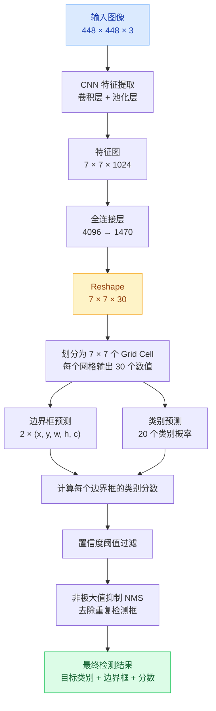
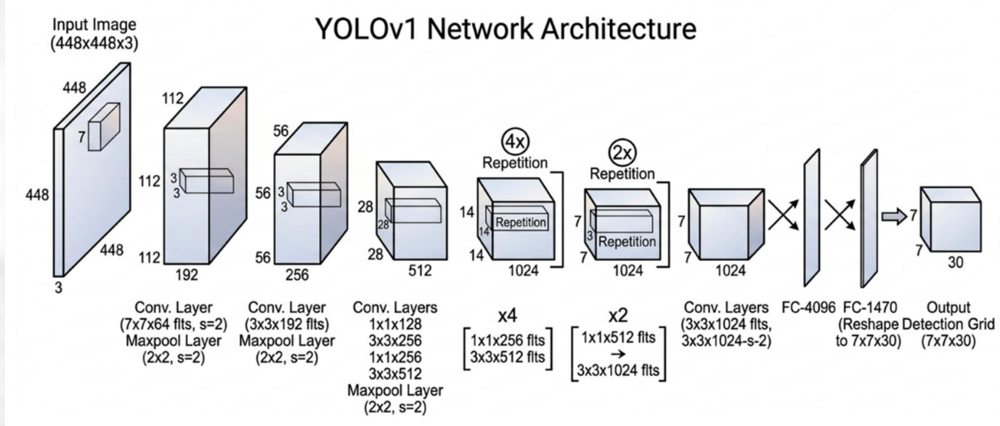
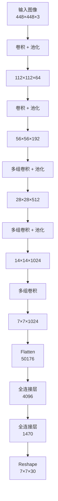
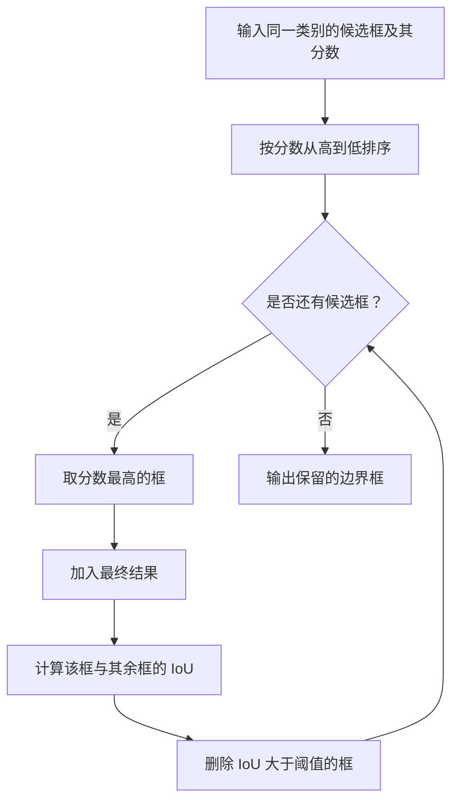
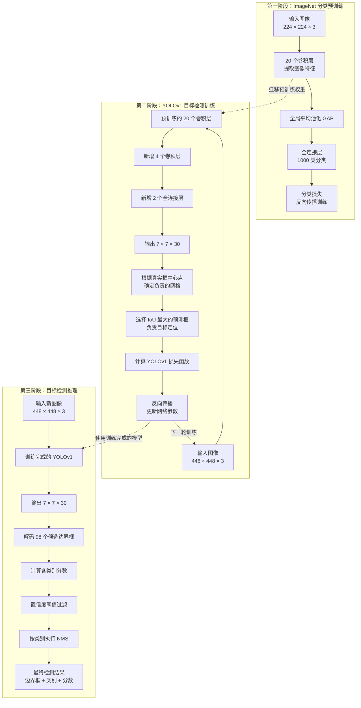

# YOLOv1 算法原理

## 目标检测与 YOLO 的基本思想

### 目标检测

在学习 CNN 的时候，我们主要讨论的是图像分类
对于图像分类，模型只需要回答，这张图片中主要是什么物体

目标检测需要回答两个问题
* 图片中有哪些物体
* 每个物体位于图片的什么位置

也就是 目标检测 = 目标定位 + 目标分类

例如，输入一张包含猫和狗的图片，目标检测模型可能输出 Cat 和 Dog 的位置(边界框)和置信分数

边界框通常是一个矩形，用于描述目标在图像中的位置和大小，它的表示常常是四个坐标

### 目标检测算法

目标检测算法可以分为两种
* 单阶段目标检测，比如 YOLO
* 双阶段目标检测，比如 Faster R-CNN

两者的主要区别在于：是否生成候选目标区域，再对这些区域进行分类和位置修正

比如双阶段，以 Fast R-CNN 为例，第一阶段首先生成候选区域，找出所有可能存在目标的位置，第二阶段进行分类与边界框回归，最后出结果

而 YOLO 采用另一种思路，直接用一个神经网络从整张图像预测目标的位置和类别信息，因此通常具有较高的检测速度，这也是 YOLO 适合实时目标检测的原因

### YOLO 的核心思想

YOLO 全称，You Only Look Once

核心思想，将目标检测统一为一个回归问题，通过一次神经网络前向传播，同时预测目标的位置和类别信息

>为什么说 YOLO 是回归问题

回归问题通常预测连续数值，而 YOLO 需要预测边界框位置 $(x, y, w, h)$
这也是连续数值，因此可以通过神经网络直接回归得到

但 YOLO 不只是回归，还需要预测物体类别，因此，更准确的说，YOLO 将边界框回归，目标置信度预测和类别预测统一在一个神经网络种完成

>为什么叫 Only Look Once

假设一张图片存在三只猫，YOLO 不需要把每只猫所在的区域单独裁剪出来，再运行一次分类网络，相反，它将整张图片输入网络，通过一次前向传播，同时得到多个候选检测框及相关预测

### YOLOv1 整体工作过程

我们先建立一个直观印象

三个阶段
* 特征提取，通过 CNN 将原始图像转换成特征图
* 预测阶段，通过全连接层得到输出，每个网格预测2个边界框和20个类别概率
* 后处理阶段，计算类别分数，过滤低分检测框，再使用 NMS 去除重复框

## 网络结构

本质上，YOLOv1仍然是一个卷积神经网络
* 24 个卷积层
* 4个最大池化层
* 2个全连接层

其中，卷积层和池化层负责提取图像特征，全连接层负责将特征映射为目标检测所需的预测数值

简化表示

YOLOv1中大量使用 $1 \times 1 \times 256$
* $1 \times 1$ 卷积可以保持空间尺寸不变的情况下，调整通道数量，从而学习更多特征

从上到下，特征图空间尺寸逐渐减少，特征通道数逐渐增加

经过一堆卷积和池化，YOLOv1最终得到特征图 $7 \times 7 \times 1024$，随后将特征图展平得到 $50176$ 的一维向量，经过两个全连接层，最后 reshape 得到输出 $7 \times 7 \times 30$

它不仅包含类别信息，还包含目标的位置与置信度信息

## 输出张量 $ 7 \times 7 \times 30$

为什么输出长这个样子？我们从网格 Grid Cell 开始一步步推导

在普通 CNN 分类任务中，网络只需要预测整张图片属于什么类别，但目标检测不同，一张图片可能包含多个物体，而且每个物体的位置不同

因此，YOLOv1采用了一种方法：将图像在逻辑上划分成 $7 \times 7$ 个网格，让不同网格负责预测不同的位置

一张图像对应 49 个网格

需要注意的是，这里的网格划分只是预测机制上的划分，并不是将原始图片真正裁剪成 49 张小图片，再分别送入 CNN
实际过程是一张图像进去，网络一次前向传播输出 $ 7 \times 7 \times 30$ 的预测张量

>那么，每个网格负责预测什么？

假设一张图片中有一只狗，狗的身体可能横跨多个网格，那么究竟由哪个网格负责预测它？

YOLOv1规定，物体中心点落在哪个网格，就由哪个网格负责预测该物体

* 网格负责预测物体：由物体中心点的位置决定
* 预测框的大小，可以超出负责预测它的网络

>为什么每个网格输出 30 个数？

YOLOv1 在 PASCAL VOC 数据集上使用 20 个目标类别

对于每个 Grid Cell，模型需要预测：  
* 两个边界框
* 每个边界框对应的置信度
* 20 个类别的条件概率

一个边界框包含由五个数表示 $(x, y, w, h, c)$，$c$ 是置信度

为什么每个模型预测两个框？因为不同的边界框预测其可以学习不同的定位特点，比如某些预测其可能更擅长预测较宽的物体，另一些可能更擅长预测较高的物体

预测两个边界框，于是就要输出 $2 \times 5 = 10$ 个数值

20个类别概率是网格共享的，这是 YOLOv1 与后续部分 YOLO 版本的重要区别之一

对于每个网格，YOLOv1 只预测一组类别条件概率
$$
P(C_i\mid\text{Object})
$$
20个类别，那么一个网格输出
$$
(P_1,P_2,\ldots,P_{20})
$$
加上前面的，一共$30$ 个输出

>YOLOv1 最多检测多少个物体？

一共 49 个网格，每个网格预测两个边界框，是不是一共可以检测 98 个？

不对，每个网格只有一组类被预测，并且 YOLOv1 的训练机制以物体中心点所在网格分配检测责任，因此一个网格难以同时正确检测多个物体

例如，两只狗的中心点恰好落在同一个网格内，YOLOv1 就可能无法将它们分别正确检测出来。

这也就是 YOLOv1 对密集排列的小目标检测效果不够理想的原因之一

## 边界框坐标 $(x, y, w, h)$

在目标检测中，一个矩形框通常可以使用两种方式表示
* 左上角和右下角坐标
* 中心点坐标与宽高 $(x_c, y_c, w, h)$

YOLOv1 使用第二种方法

不过 YOLOv1 输出的坐标相当于做了归一化

* $x, y$ 的归一化：相当于对 Grid Cell 归一化
 

假设一张图片大小为 $448 \times 448$，划分为$7 \times 7$，那么每个网格对应的空间大小为 $
\frac{448}{7}=64 $ 
即每个网格对应原图中的 $64 \times 64$ 区域

现在假设我们研究第 3 行，第 4 列的网格(行列从0开始)，它的左上角像素坐标为
$$
(4 \times 64, 3 \times 64) = (256, 192)
$$
如果模型预测
$$
x = 0.5, y = 0.25
$
$
那么实际像素坐标应该是
$$
x_c = (4 + 0.5) \times 64 = 288, y_c = (3 + 0.25) \times 64 = 208
$$
* $w, h$ 的归一化：对整张图像而言

边界框的宽度和高度是对整张图像来说的，不是相对于网格

模型输出
$$
w = 0.43, h = 0.40
$$
实际像素坐标
$$
w_{piexl} = 0.43 \times 448 = 192.64,
h_{piexl} = 0.40 \times 448 = 179.2
$
$
为什么要这样设计？因为一个目标可能远远大于一个网格，例如，一辆自行车可能横跨 4 个甚至更多网格，如果将宽高限制在一个网格内，就无法自然地表示这些大目标

## IoU(交并比)与置信度

前面我们学习了 YOLOv1 如何预测边界框的位置，但是，仅仅预测出一个矩形框还不够

例如，模型在图片中预测出了一个狗的边界框，我们还需要知道

* 这个框里面是否真的存在物体
* 这个框与物体的真实位置有多接近
* 我们应该相信这个预测框吗

为了解决这些问题，YOLOv1 引入了两个重要概念，IoU 和 Confidence

### IoU 交并比

全称 Intersection over Union，中文 交并比

它用于衡量两个边界框之间的重叠成都

在目标检测中，我们通常比较
* 真实边界框，数据集标注的目标位置
* 预测边界框，神经网络预测出来的位置

IoU 定义为
$$
{\operatorname{IoU}(A,B)=\frac{|A\cap B|}{|A\cup B|}}
$$
分子为边界框交集面积，分母为并集面积

### Confidence 置信度

现在，我们已经知道如何衡量预测框的准确程度

但是，假设 YOLOv1 预测出了两个框：
- 框 A：里面确实有一只猫。
- 框 B：里面什么物体也没有，只是一块背景

仅仅预测位置，无法告诉我们哪个框更值得保留，因此，每个预测框还需要输出一个置信度 $c$

在 YOLOv1 中，置信度的定义为
$$
C=\Pr(\text{Object})\times\operatorname{IoU}_{pred}^{truth}
$$
* $Pr(Object)$ 描述的是当前预测对应的区域是否存在目标类别物体
* $IoU_{pred}^{truth}$ 衡量预测框与真实框的重叠程度，描述了预测框的定位质量

两者相乘可以同时反应目标存在性和定位质量

>那么，预测时没有真实框，怎么计算 IoU？

训练时利用真实框构造监督目标，推理时由神经网络直接预测置信度

>为什么一个网格的两个边界框需要分别预测置信度？

前面我们提及，一个网格输出两个边界框，这两个边界框共享类被概率，但是它们的位置和大小可能不同，于是定位质量不同，置信度自然也不同

## YOLOv1的类别概率与最终预测分数

置信度并不能告诉我们框里的物体究竟是什么，YOLOv1 还需要进行类别预测

YOLOv1 使用的 PASCAL VOC 数据集包含 20 跟目标类别，因此，每个网格还需要输出 20 个类别条件概率
$$
P(C_1\mid\text{Object}),\ldots,P(C_{20}\mid\text{Object})
$$
即存在目标物体的条件下，该物体属于第 $i$ 个类别的概率

>如何计算一个边界框属于某个类别的分数？

现在我们有了两类预测结果
* 边界框置信度 $c_j$
* 网格的类别条件概率 $P(C_i\mid\text{Object})$

YOLOv1 将它们相乘，得到预测分数
$$
S_{i,j} = P(C_i\mid\text{Object}) \times c_j
$$

## NMS(非极大值抑制)算法

假设一张图片只有一只狗，模型却输出了三个预测框，如果直接输出这三个框，最终检测结果会存在重复，我们希望的是：同一个目标只保留一个比较可靠的边界框

NMS 的核心思想就是，有限保留分数最高的预测，然后删除与它高度重叠的低分框

YOLOv1 常见后处理方式中，是对每个类别分别执行 NMS，这样不同类别的目标就不会因为彼此重叠而直接互相抑制

## 损失函数

定义损失函数，才可以利用反向传播不断更新网络参数

对于 YOLOv1，每个 Grid Cell 输出
$$
(x_1,y_1,w_1,h_1,c_1,\ x_2,y_2,w_2,h_2,c_2,\ P_1,\ldots,P_{20})dd
$$
这些数值承担不同任务

因此，YOLOv1 的总损失可以写成
$$
L = L_{coord} + L_{conf} + L_{class}
$$

### 坐标损失

一个网格预测两个边界框 $B_1, B_2$，训练数据有一个真实边界框 $GT$
假设
$$
IoU(B_1, GT) = 0.8, IoU(B_2, GT) = 0.5
$$
YOLOv1 会选择与真实框 IoU 更大的 $B_1$ 负责这个目标
因此，$B_1$ 参与坐标损失计算，$B_2$ 不参与

为什么呢？因为如果强迫两个预测其都学习相同的真实框，它们就更容易产生相似的预测，YOLOv1 希望不同的边界框预测器能够逐渐学习不同的定位特点

#### 责任指示变量

为了在数学公式中表示哪个预测框负责目标，YOLOv1 使用指示变量 $1_{ij}^{obj}$
* $i$ 第 $i$ 个网格
* $j$ 网格的第 $j$ 个边界框
* $obj$ 表示这个预测框负责某个真实目标

它的取值为
$$
\mathbb{1}_{ij}^{obj}=
\begin{cases}
1,&\text{第 }j\text{ 个框负责该目标}\\
0,&\text{否则}
\end{cases}
$$

#### 中心点坐标损失

为了让预测中心点接近真实中心点，最直接的方法就是计算平方误差
$$
L_{xy}=(x_i-\hat{x}_i)^2+(y_i-\hat{y}_i)^2
$$
考虑所有网格和边界框，就是
$$
{
L_{xy}=
\lambda_{\text{coord}}
\sum_{i=1}^{S^2}
\sum_{j=1}^{B}
\mathbb{1}_{ij}^{obj}
\left[
(x_{ij}-\hat{x}_{ij})^2+
(y_{ij}-\hat{y}_{ij})^2
\right]
}
$$
其中 $S = 7, B =2$，而 $\lambda_{coord} = 5$，这是 YOLOv1 用于提高坐标损失权重的系数

#### 宽高损失

宽高不能直接平方误差，需要先开方

举个例子，考虑绝对误差为 0.1 的两个目标
一个比较大的目标，$\hat w = 0.8$，$ w = 0.7$，绝对误差为 0.1
一个比较小的目标，$\hat w = 0.2$，$ w = 0.1$，绝对误差为 0.1
使用平方误差是 0.01
但是从相对误差来看
* 大目标，宽度误差占真实宽度的 12.5%
* 小目标是 50%

也就是说，相同的绝对误差，对小目标的影响可能更加严重

YOLOv1 为了缓解这个问题，先开方，再计算平方误差
$$
L_w=(\sqrt{w}-\sqrt{\hat{w}})^2
$$
这样，相同的宽度绝对误差，小目标产生的损失更大

#### 完整坐标损失
$$
\begin{aligned}
L_{\text{coord}}={}&
\lambda_{\text{coord}}
\sum_{i=1}^{S^2}\sum_{j=1}^{B}
\mathbb{1}_{ij}^{obj}
\left[(x_{ij}-\hat{x}_{ij})^2+(y_{ij}-\hat{y}_{ij})^2\right]\\
&+
\lambda_{\text{coord}}
\sum_{i=1}^{S^2}\sum_{j=1}^{B}
\mathbb{1}_{ij}^{obj}
\left[
(\sqrt{w_{ij}}-\sqrt{\hat{w}_{ij}})^2+
(\sqrt{h_{ij}}-\sqrt{\hat{h}_{ij}})^2
\right]
\end{aligned}
$$
>为什么坐标损失权重 $\lambda_{coord}$ 是 5？

YOLOv1 的每张图像对应 98 个候选边界框，但在很多训练图像中，真实物体数量远少于这个数
也就是说，只有少数预测框负责真实慕白哦

如果所有损失都具有相同权重，模型的训练可能过度受到大量背景预测框的映射

因此 YOLOv1 采用两种权重调整
$$
\lambda_{coord} = 5, \lambda_{noobj} = 0.5
$$
前者提高坐标损失的影响，后者降低无目标置信度损失的影响

这两个系数是 YOLOv1 采用的超参数，不是数学上的唯一正确数值

### 置信度损失

如果一个网格中存在物体，两个边界框都预测了置信度，但只有一个负责定位，另一个边界框应该如何训练？

首先区分三种训练情况
* 有物体，负责预测，学习坐标和置信度
* 有物体，不负责预测，抑制置信度
* 网格没有物体，抑制置信度

于是，置信度损失分成两部分
$$
L_{conf} = L_{obj} + L_{noobj}
$$

* 有目标且负责预测的情况

前面置信度的定义
$$
C = P(Object) \times IoU_{pred}^{truth}
$$
对于负责某个目标的预测框，$P(Object) = 1$
因此 
$$
C_{target} = IoU_{pred}^{truth}
$$
那么，置信度损失为
$$
L_{\text{obj}}=
\sum_{i=1}^{S^2}
\sum_{j=1}^{B}
\mathbb{1}_{ij}^{obj}
(c_{ij}-\hat{c}_{ij})^2
$$
* 不负责目标的情况

假设一个网格中，$B_1$ 的 IoU 高于 $B_2$，这种情况，YOL;Ov1 不要求它拟合该物体的真实坐标，那么，它在无目标置信度损失项中的监督目标是
$$  
\hat c_2 = 0
$$
在一张图片中，通常有大量预测框没有负责真实目标，为了防止这些大量无目标置信度误差主导训练，通常设置超参数 $\lambda_{noobj}$

于是
$$
t{noobj}}=
\lambda_{\text{noobj}}
\sum_{i=1}^{S^2}
\sum_{j=1}^{B}
\mathbb{1}_{ij}^{noobj}
(c_{ij}-0)^2
\]
$$

### 类别损失

类别损失是在网格层面计算的

直接平方误差搞定
$$
L_{\text{class}}=
\sum_{i=1}^{S^2}
\mathbb{1}_i^{obj}
\sum_{c\in\text{Classes}}
(p_i(c)-\hat{p}_i(c))^2
$$

## 完整训练与推理流程

YOLOv1 采用两阶段训练，先训练图像分类网络，再将它改造成目标检测网络

图像分类和目标检测的输出虽然不同，但它们都需要学习图像特征
因此，我们可以先使用大量分类数据训练卷积神经网络，让它具备良好的特征提取能力，然后再次学习如何定位物体

这种方法称为 与训练 与 微调

NMS 只负责推理时的后处理，不参与反向传播

